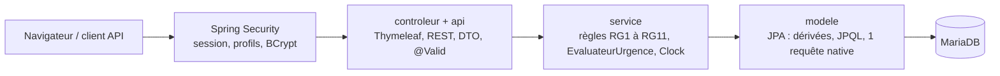

# 🚉 TrainStation

> **Chaque panne a une horloge.** TrainStation suit les équipements d'un réseau de transport, de la panne déclarée
> sur le quai jusqu'à la note du prestataire, et montre au responsable d'exploitation, d'un coup d'œil,
> quel incident attend depuis trop longtemps.

Projet final ALTN72 (Développement Full Stack avec Java, 2026-27) par **Alexandre GINISTY** et **Florian DE SOUSA**.


**En ligne :** https://trainstation-vmfz.onrender.com (hébergement gratuit : compter une minute au premier chargement)
**Le détail des choix** (droits, exceptions, SOLID, requête native, `@Transactional`, bilan) est dans le [journal](journal.md).

---

## Le feu tricolore

Le tableau de bord ne stocke aucune couleur : il la recalcule à chaque affichage à partir de l'heure courante
(une `Clock` injectée, figée dans les tests).

| Incident | Depuis l'ouverture | Affichage |
|---|---|---|
| Sans prestataire | moins de 48 h | 🟢 Vert |
| Sans prestataire | 48 h incluses à moins de 72 h | 🟠 Orange |
| Sans prestataire | 72 h et plus | 🔴 Rouge |
| Pris en charge par un prestataire | peu importe | 🔵 Affecté, jamais tricolore |
| Résolu | | quitte le tableau de bord, reste dans l'historique |

Les seuils 48 h et 72 h sont deux constantes nommées, définies une seule fois dans `EvaluateurUrgence`.

## Essayer en 2 minutes

**Prérequis :** Java 21 et une MariaDB locale (XAMPP convient). Maven est fourni par le wrapper.

```bash
# 1. Créer la base, le schéma et les données de démo (dates relatives à maintenant)
mysql -u root < db/create.sql

# 2. Lancer
./mvnw spring-boot:run          # Windows : mvnw.cmd spring-boot:run
```

Puis ouvrir http://localhost:8080. Sans variable d'environnement, l'application vise
`jdbc:mariadb://localhost:3306/Base_ALTN72` avec `root` sans mot de passe. Pour une autre base :
`DB_URL`, `DB_USER`, `DB_PASSWORD`. Aucun secret n'est versionné.

| Compte | Mot de passe | Profil | Peut… |
|---|---|---|---|
| `resp` | `password` | Responsable d'exploitation (Florian) | tout : affecter, résoudre, évaluer, superviser |
| `agent` | `password` | Agent (Alexandre) | consulter et déclarer une panne |

Les mots de passe sont stockés hachés en BCrypt. Les restrictions sont vérifiées côté serveur
(Spring Security), pas seulement en masquant les boutons.

## Une démo en six scènes

1. **07 h 52, l'agent signale.** Connecté en `agent`, il ouvre une station, choisit l'escalator en panne et
   déclare l'incident (F2, F3, F4). Le tableau de bord lui est refusé côté serveur, même en tapant `/supervision` à la main.
2. **Le responsable arrive.** Connecté en `resp`, il ouvre le **tableau de bord** (F11) : les données de démo
   contiennent des incidents à 10 h, 47 h, 48 h, 72 h et 100 h, donc les trois couleurs et leurs bornes exactes.
3. **Il trie.** Filtres combinables par station et par niveau, tri par urgence ou par ancienneté
   (lot alpha 1, supervision avancée).
4. **Il agit.** Sur l'incident rouge, il affecte un prestataire (F7) : l'incident passe en « affecté » et perd
   sa couleur. Il peut corriger la description (F6) et réaffecter tant que ce n'est pas résolu.
5. **La panne est réparée.** Il déclare l'incident résolu (F8) puis note le prestataire de 1 à 5 (F10).
   L'incident rejoint l'**historique** (F9), du plus récent au plus ancien.
6. **Vue d'ensemble.** La page **statistiques** (lot alpha 2) montre trois graphiques Chart.js : incidents
   actifs par station, équipements par type, note moyenne par prestataire.

## L'API REST

Documentée avec Swagger : http://localhost:8080/swagger-ui.html

```text
GET  /api/incidents                      liste des incidents
GET  /api/incidents/{id}                 un incident (404 s'il n'existe pas)
POST /api/incidents/{id}/affectation     affecter un prestataire (responsable)
POST /api/incidents/{id}/resolution      résoudre (responsable, 409 si déjà résolu)
```

Les erreurs passent par un `@RestControllerAdvice` qui traduit les exceptions métier (toutes dérivées
d'`ExceptionMetier`, messages en français) en 400, 404 ou 409. Côté pages, un `@ControllerAdvice`
affiche un message lisible, sans trace technique.

## Ce qui se passe sous le capot



```text
src/main/java/altn72/…
├── api/         API REST et sa gestion d'erreurs
├── config/      sécurité, horloge, OpenAPI
├── controleur/  pages Thymeleaf
├── dto/         formulaires et objets échangés
├── exception/   exceptions métier
├── modele/      entités et repositories
└── service/     règles métier
db/create.sql    base + données de démo, recréées en quelques secondes
journal.md       choix techniques, lot alpha, bilan
```

## Tests

```bash
./mvnw verify
```

35 tests, sur H2 en mémoire (pas besoin de MariaDB) : seuils à 47 h, 48 h, 71 h et 72 h avec une horloge
figée, état distinct d'un incident affecté, interdiction de réaffecter un résolu, ordre de l'historique,
règles d'évaluation, droits par profil via MockMvc, 404 de l'API, validation des formulaires.

## Limites connues

- Hébergement gratuit : l'application s'endort après 15 min sans visite, la base Aiven s'éteint après une
  longue inactivité.
- Le filtrage par couleur du tableau de bord se fait en mémoire (la couleur n'existe pas en base) :
  parfait pour un réseau, pas pour des millions d'incidents.
- Pas de choix de période sur la page statistiques.
