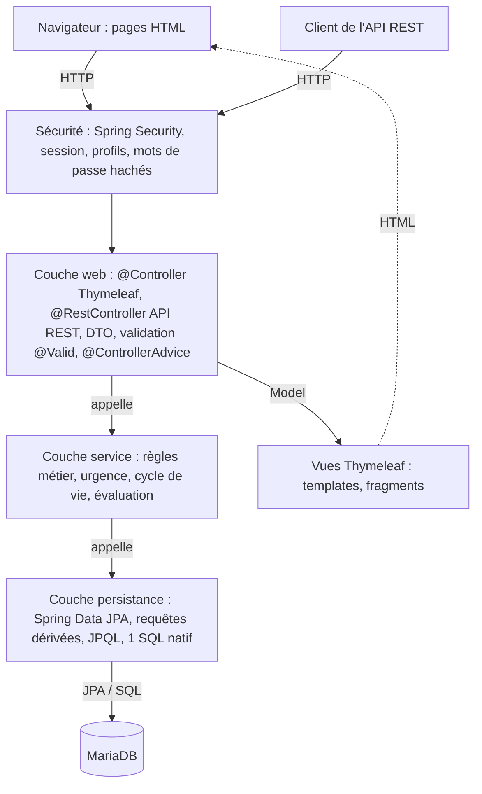

# Journal : TrainStation (ALTN72, 2026-27)

**Groupe :** Alexandre GINISTY, Florian DE SOUSA

## README

- **Prérequis** : Java 21, Maven (wrapper `./mvnw` fourni), MariaDB.
- **Configuration** : identifiants de la base lus dans les variables d'environnement `DB_USER` (défaut `root`) et `DB_PASSWORD` (défaut vide). Aucun secret n'est versionné.
- **Initialiser la base** : exécuter `db/create.sql` (crée `Base_ALTN72`, le schéma et les données de démonstration).
- **Lancer** : `./mvnw spring-boot:run`, puis ouvrir `http://localhost:8080`. Documentation de l'API : `http://localhost:8080/swagger-ui.html`.
- **Comptes de test** (mot de passe : `password`) :
  - `resp` : Florian, Responsable d'exploitation.
  - `agent` : Alexandre, Agent.
- **Données de démonstration** : trois stations, six équipements de types variés, incidents non affectés ouverts depuis 10 h, 47 h, 48 h, 72 h et 100 h (bornes de RG3), un incident affecté, deux incidents résolus et une évaluation. Les dates sont calculées par rapport à l'heure d'exécution du script.
- **Limites connues** : application non déployée.

## ARCHITECTURE

- **Dépôt** : https://github.com/Ianouu1/TrainStation
- **Schéma** :

Correspondance avec les packages : couche web dans `controleur` (pages) et `api` (REST), objets échangés dans `dto`, règles métier dans `service`, entités et repositories dans `modele`, exceptions métier dans `exception`, configuration (sécurité, horloge, OpenAPI) dans `config`.

## TESTS

- **Stratégie** : tests unitaires des règles métier, sans contexte Spring et avec une horloge figée ; tests d'intégration de la persistance et de la couche web sur une base H2 en mémoire.
- **Commande** : `./mvnw verify` (35 tests, MariaDB non nécessaire).
- **Tests unitaires** : `EvaluateurUrgenceTest`, `IncidentServiceTest`, `EvaluationServiceTest`, `SupervisionServiceTest`, `ValidationFormulairesTest`, `MotDePasseDemoTest`.
- **Tests d'intégration** : `IncidentRepositoryTest` (`@DataJpaTest`), `PagesWebTest` et `IncidentApiControleurTest` (`@SpringBootTest` + MockMvc).
- **Couvert** : seuils d'urgence à 47 h, 48 h, 71 h et 72 h (RG3), présentation distincte d'un incident affecté (RG4), réaffectation d'un incident résolu interdite (RG5), incidents résolus absents des actifs (RG6), historique du plus récent au plus ancien (RG7), règles d'évaluation (RG8), droits par profil (RG11), réponse 404 de l'API pour un incident inexistant (F12), validation des formulaires (description de 10 à 1000 caractères, note de 1 à 5), page d'erreur lisible pour une adresse invalide.
- **Non couvert** : parcours complets dans un navigateur réel, que les tests MockMvc ne remplacent pas entièrement.

## CHOIX TECHNIQUES

- **Droits par profil** (appliqués côté serveur dans `ConfigurationSecurite`) :

  | N° | Fonctionnalité | Responsable d'exploitation | Agent |
  | --- | --- | --- | --- |
  |   | F2-F3 Consulter équipements et fiches | Accès complet | Accès complet |
  | F4 | Déclarer un incident | Accès complet | Accès complet |
  |   | F5-F6 Consulter / modifier un incident | Accès complet | Lecture seule |
  | F7 | Affecter ou réaffecter un prestataire | Accès complet | Interdit |
  | F8 | Déclarer un incident résolu | Accès complet | Interdit |
  | F9 | Consulter l'historique | Accès complet | Accès complet |
  | F10 | Évaluer un prestataire | Accès complet | Interdit |
  | F11 | Tableau de bord | Accès complet | Interdit |

  Seul le responsable peut modifier un incident (F6), et uniquement sa description : l'équipement et la date d'ouverture restent figés pour garder un historique fiable.
- **Exceptions** : `@ControllerAdvice` (pages web) et `@RestControllerAdvice` (API) plutôt que `ResponseStatusException`. La traduction des erreurs est centralisée, et les services ne lèvent que des exceptions métier en français, toutes dérivées d'`ExceptionMetier`, sans dépendre de HTTP. Une ressource inexistante donne un 404, une transition d'état interdite un 409. Les gestionnaires journalisent l'erreur (SLF4J) là où elle est traitée, et nulle part ailleurs. Une saisie invalide est rejetée dès l'entrée (Bean Validation) et réaffiche le formulaire avec son message ; une adresse invalide donne un 400. Les pages affichent un message lisible, sans trace technique ; une erreur imprévue n'affiche qu'un message générique. `ResponseEntity` n'est utilisé que dans l'API, pour choisir le code de statut.
- **SOLID** :
  - **S** (appliqué) : `EvaluateurUrgence` ne fait que calculer l'indicateur. Les seuils de 48 h et 72 h ne changent donc qu'à un seul endroit.
  - **D** (appliqué) : injection par constructeur avec attributs `final`, et dépendance à une `Clock` injectée plutôt qu'à `LocalDateTime.now()`. Les tests figent l'horloge pour vérifier les seuils à l'heure près.
- **Requête SQL native** : `IncidentRepository.compterIncidentsActifsParStation()` compte les incidents actifs par station. Elle reste lisible pour une agrégation sur trois tables, mais elle dépend des noms de colonnes et du dialecte SQL, n'est pas vérifiée au démarrage et renvoie un `Object[]` non typé. Une requête JPQL avec projection serait plus sûre à maintenir.
- **@Transactional** : sur les méthodes de service qui écrivent (`declarerIncident`, `affecterPrestataire`, `resoudreIncident`, `modifierDescription`, `evaluer`), pour qu'une exception métier annule toute l'opération (RG10). Dans `ApiIncidentService`, pour garder la session ouverte pendant la conversion des entités en DTO : en `readOnly = true` pour la consultation, en écriture pour résoudre et affecter.

## LOT ALPHA

### Fonctionnalité transverse 1 : Supervision avancée
- **Objectif** : filtrer et trier le tableau de bord pour repérer rapidement les incidents prioritaires.
- **Progression** : réalisée après le tableau de bord (F11), en réutilisant ses lignes et son calcul d'urgence.
- **Essais** : le filtrage par niveau d'attention ne peut pas se faire en base, puisque l'indicateur est calculé à partir de l'heure courante et n'est pas enregistré (RG4). Il est donc appliqué en mémoire, après le calcul.
- **Résultat** : filtres combinables par station et par niveau (vert, orange, rouge, affecté), tri par urgence ou par ancienneté. Les critères restent affichés après filtrage.
- **Limites** : filtrage en mémoire, adapté au volume d'un réseau mais pas à un très grand nombre d'incidents.

### Fonctionnalité transverse 2 : Visualisation des données
- **Objectif** : donner au responsable une vue synthétique de la situation.
- **Progression** : requêtes d'agrégation ajoutées aux repositories, puis page de graphiques.
- **Essais** : les données sont transmises aux graphiques par l'inlining JavaScript de Thymeleaf, ce qui évite un appel API supplémentaire.
- **Résultat** : page `/supervision/statistiques` avec trois graphiques Chart.js : incidents actifs par station (requête native), équipements par type et note moyenne par prestataire (JPQL).
- **Limites** : pas de choix de période d'analyse.
